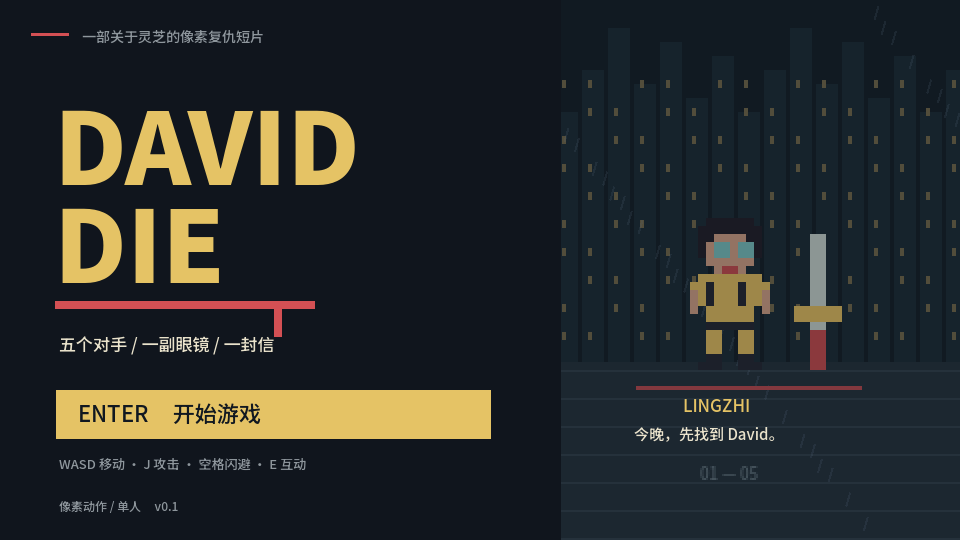

# DAVID DIE · v0.7

灵芝要帮高申追回被 David 偷走的快递。四场 Boss 战串起放映室、医院、海边、旧码头和仓库，最后通向一封需要特殊光源才能读出的信，以及 20 岁生日场景和快递开箱。

当前 main 为 v0.7 源码，包含难度选择、场景机关、支援任务、Boss 练习场与清爽香水开箱。公开 Release 附件仍为 v0.1.0 历史原型，尚未替换为新版。



## 运行当前版本

用 **Godot 4.6.2 标准版**导入 `source/project.godot`，然后运行工程。没有插件、账号或联网依赖。导出 Windows / macOS 前，在 Godot 中安装同版本的官方导出模板。

历史试玩包（v0.1.0，内容早于当前源码）：[Windows](https://github.com/Doooooooove/david-die/releases/download/v0.1.0/DavidDie-Windows.zip) · [Mac](https://github.com/Doooooooove/david-die/releases/download/v0.1.0/DavidDie-macOS.zip) · [v0.1 源码](https://github.com/Doooooooove/david-die/releases/download/v0.1.0/DavidDie-source.zip)。解压后可直接运行，无需安装 Godot。Mac 包支持 Apple Silicon 和 Intel，采用临时签名，未经 Apple 公证。

## 玩法和流程

- 看电影的人正在看《Kill Bill》。打败他后问出快递去向；灵芝突然腹痛，先去医院。
- 去医院途中眼镜鼻托掉落，场景模糊。找回鼻托后需要用鼠标拖动安装，再找医生、做 CT。
- 到海边拿鱼竿，在钓鱼点抛竿，咬钩后收竿，钓出 DeepSeek 小鲸鱼。它会飞起砸落，红圈提前预告落点。战场的岩浆河上有八台收音机拼成的桥；桥面和两岸安全，踏入岩浆会按间隔烫伤。
- 击败鲸鱼取得通行牌，沿可走动的栈道进入 1006 的档案室。奶牛 1006 使用红包雨和红色冲撞，战败后说出 David 的位置。
- 沿仓库走廊找到 04 号仓库，打败最终 Boss David，取回高申的快递与信。
- 进入暗室，取得特殊光源并照亮信纸。旁边的浅色气球大拱门、蛋糕和生日布置亮起；走进拱门，亲手拆开快递，取出一瓶清爽香水。

## 对白与任务

对白带说话人头像、逐字显示和换行；E / Enter 先显示整句，再进入下一句。按 Tab 可暂停查看任务手账，回顾线索与当前目标，Tab / Esc 收起。

## v0.7 新玩法

标题页可选择轻松、标准、挑战三档难度。按 R 进入 Boss 练习场，重打已遇见的对手，按难度分别保存最好用时；高申升级后的成绩不会覆盖普通纪录，练习也不改变主线进度。

每个战场都有一次机关：暂停放映、广播诱饵、红包退订、弹丸反射。两段过场中可调频或核对包裹，任选额外补给、闪避加速、反击强化带入下一战。支援可跳过，同章重试保留。钓鱼增加绿色区域收线小游戏，失误后判定逐步放宽。

## 战斗

按住攻击可打出三连击，第三击是范围和伤害更大的重斩。Boss 收招时反击伤害更高，伤害飘字和连击格反馈命中。第三击在收招期可延长破绽，每次收招只触发一次；引诱冲撞撞墙也能获得更长反击窗口。收招倒计时条与鲸鱼收缩落点圈帮助判断时机。

在闪避过程中躲掉实际命中，会获得一次短暂的反击加成，并缩短下次闪避的等待时间。挥空不会立即消耗反击。闪避支持短暂的提前输入。

标准难度每场战斗可用一次补给，恢复最多 35 体力，满血时不会浪费。战败后可以选择让高申复活、先休息，或让高申升级。升级播放光圈、扫描光与悬浮动画，随后以 150 体力和 1.5 倍攻击重试当前 Boss；同关保留强化，重复升级不叠加，下关恢复普通数值。重试恢复补给，无需重复钓鱼或对白。每进入一场 Boss 战会保存章节；标题页按 E 可继续最近章节，Enter 开始新游戏。

Boss 半血后进入第二阶段：放映室增加冲撞，鲸鱼二连砸落并为每次砸落重新预警，1006 的红包雨更密，David 的攻击序列增加冲撞。血条中点和 II 标记提示阶段变化。

## 操作

| 操作 | 按键 |
| --- | --- |
| 移动 | WASD / 方向键 |
| 三连击 | J / 鼠标左键，可按住 |
| 战斗闪避 | 空格 / K |
| 探索快走 | 按住空格 / K |
| 使用补给 | Q |
| 互动、钓鱼、场景机关、对白、开门、开快递 | E |
| 开始、确认、对白、结局返回 | Enter |
| 死亡菜单 | ↑↓ / W S 选择，Enter / E 确认；数字 1 / 2 / 3 或鼠标直接选 |
| 标题页难度 / 练习场 | 左右键 / R，也可鼠标点击 |
| 任务手账 / 收起 | Tab；Esc 也可收起 |
| 暂停 / 继续 | Esc |
| 结尾轻喷香水 | E |
| 特殊光源 | F 开关，或点击信纸开灯；鼠标移动光斑 |
| 安装鼻托 | 鼠标拖动鼻托到中央金色槽，松开 |
| 静音 / 全屏 | M / F11 |

## 验证和工程

169 项自动检查通过，覆盖完整剧情、四场战斗、鼻托拖动、医院 CT、钓鱼、飞砸、红包雨、三连击、反击、补给、第二阶段、逐字对白、手账暂停、重斩失衡与撞墙、香水喷雾、收音机桥安全过河与岩浆伤害、死亡三选项、升级伤害与时序、同关保留及跨关重置、信件解密与生日开箱。另验证四种机关、三类支援、难度差异、练习场记录和存档。三档难度下的 12 场完整战斗均可通关；Mac 原生渲染检查完成，Windows 和 Intel Mac 尚未实机测试。

```sh
godot --headless --path source --script res://tests/run.gd
```

`story.gd` 保存对白与 Boss 数据；`game.gd` 负责战斗、流程、交互、界面和存档；`world.gd` 绘制像素角色与场景；`tests/run.gd` 包含自动检查。

礼物已确定为清爽香水。当前开箱展示原创浅青玻璃瓶、水光与喷雾，结尾可按 E 轻喷一下；原有信件与生日祝福保留。

## 素材与许可

场景、其他像素角色和合成声音为本项目制作。电视只使用《Kill Bill》标题图案，没有嵌入电影视频或原声。DeepSeek 鲸鱼像素轮廓缩制自官方标志，来源与权属说明见 [DEEPSEEK-NOTICE.txt](source/assets/DEEPSEEK-NOTICE.txt)。本项目未接入 DeepSeek 服务，也不代表官方。

- 引擎：[Godot](https://godotengine.org/)，MIT 许可，见 [GODOT-LICENSE.txt](GODOT-LICENSE.txt)。
- 中文字体：[Noto Sans SC](https://github.com/google/fonts/tree/main/ofl/notosanssc)，SIL Open Font License，见 [FONT-LICENSE.txt](FONT-LICENSE.txt) 和 [OFL.txt](source/assets/OFL.txt)。
